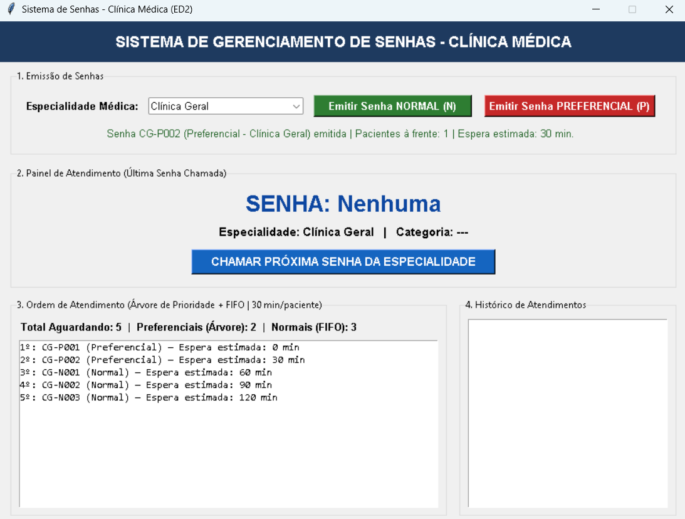
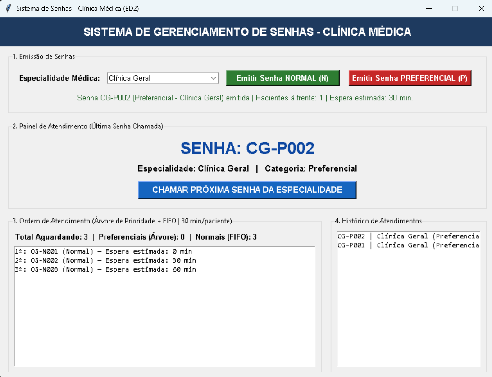
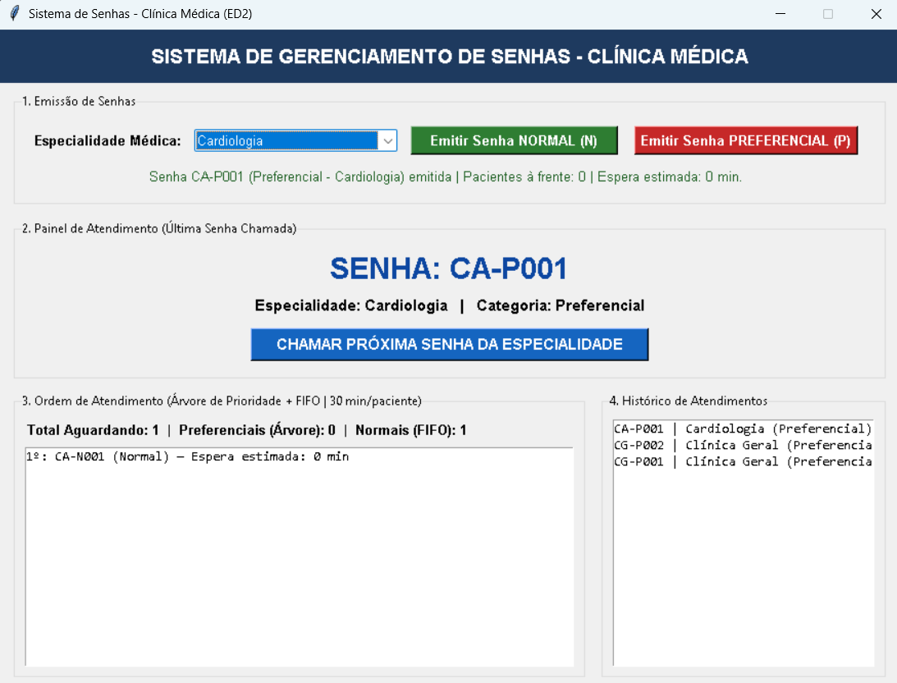
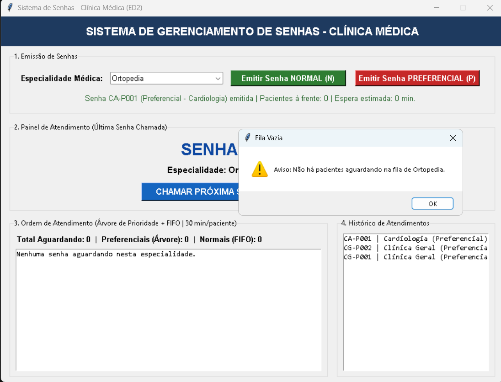

# Sistema de Gerenciamento de Senhas - Clínica Médica

## Sobre o projeto

O sistema foi feito em Python usando Tkinter para organizar o atendimento de uma clínica médica com três especialidades: Clínica Geral, Cardiologia e Ortopedia. 

A ideia é permitir que o atendente emita senhas normais (`N001`, `N002`...) ou preferenciais (`P001`, `P002`...) identificadas pela sigla de cada especialidade (`CG`, `CA` e `OR`) para não misturar as filas. Conforme os pacientes vão sendo chamados, o painel atualiza na tela qual foi a última senha, a especialidade, a categoria e joga o atendimento para o histórico na lateral. O sistema também calcula o tempo estimado de espera considerando 30 minutos por consulta multiplicados pela quantidade de pessoas na frente.

## Estruturas de dados e regra de prioridade

O código ficou dividido em `estruturas_fila.py`, `controller.py`, `interface_tkinter.py` e `main.py` para separar a interface da lógica das estruturas:

- **Árvore de Prioridade (`ArvorePrioridade`):** implementada como um Min-Heap em vetor para controlar os pacientes preferenciais (`P`). Ela usa a prioridade e a ordem de chegada para manter sempre o preferencial mais antigo no topo.
- **Fila FIFO (`FilaFIFO`):** implementada com `collections.deque` para os pacientes normais (`N`), seguindo a ordem normal de chegada.

Na hora de chamar o próximo paciente, o sistema sempre verifica primeiro a árvore de prioridade daquela especialidade. Só quando não tem nenhum paciente preferencial esperando é que ele chama da fila normal. Dentro de cada categoria, quem chegou primeiro é atendido primeiro, e cada especialidade funciona de forma totalmente independente das outras.

## Como executar

Como o Tkinter já vem instalado por padrão no Python no Windows, basta clonar o repositório e rodar o arquivo principal.

## Vídeo demonstrativo

Link do vídeo mostrando a execução do projeto, emissão de senhas, chamada prioritária e tratamento de fila vazia: [Assistir vídeo](ssdc.mp4)

## Prints do sistema

Tela com senhas normais e preferenciais emitidas, mostrando a prioridade na fila e o tempo estimado de espera:

Chamada de senha preferencial, painel atualizado e histórico de atendimentos registrado:

Alternando para outra especialidade com fila independente:

Aviso exibido quando tenta chamar uma senha com a fila vazia:

